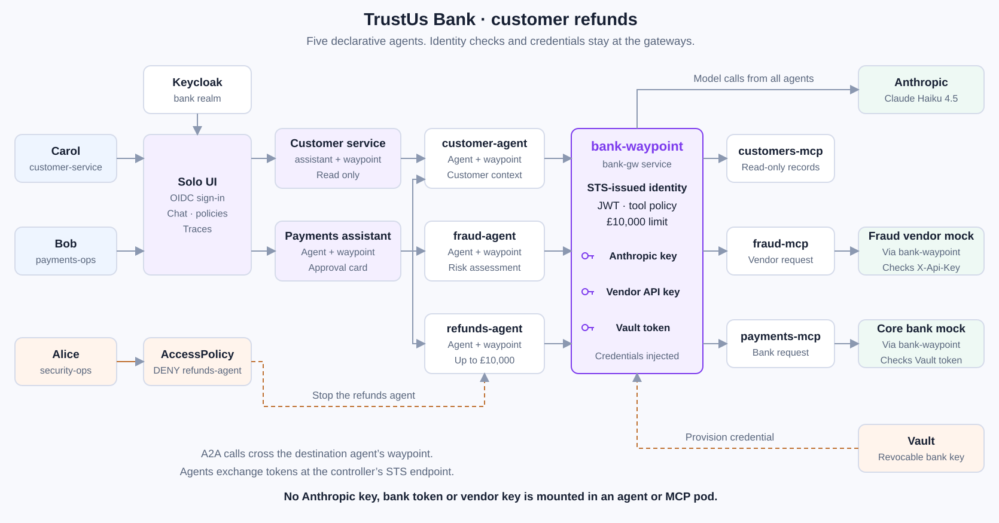

# TrustUs Bank: refunding a customer with an AI agent

Carol checks a failed payment. Bob's payments assistant asks three specialists
to investigate, refunds £1,250 and waits for approval before refunding £25,000.
Alice can stop the refunds agent with one policy. Compliance follows the trace.

The bank, fraud vendor and payment records are synthetic. No money moves.

## Run

Requirements: Docker with `docker image save --platform`, kind, kubectl, Helm,
Python 3 with PyYAML and access to the
Solo Istio image registry. The sourceable secrets file must provide
`SOLO_ISTIO_LICENSE_KEY`, `SOLO_LICENSE_KEY`, `AGENTGATEWAY_LICENSE_KEY` and
`ANTHROPIC_API_KEY`. No key is written to the manifests.

```bash
export SECRETS_FILE="$HOME/code/solo/secrets/secrets-envs.sh"
cd trustusbank-agent-refund-kind
bash scripts/quick.sh up
bash scripts/quick.sh test
```

The scripts use only `kind-trustusbank-lab`. `test` resets the mock bank's
receipts, runs the eight steps and negative controls, restores the kill switch
and writes `/tmp/trustusbank-evidence.json` and `/tmp/trustusbank-traces.json`.
The latter supplies the staff console's live trace links.

Keep these forwards open in separate terminals:

```bash
bash scripts/ui-forward.sh kagent     # http://localhost:18380
bash scripts/ui-forward.sh keycloak   # http://keycloak.localtest.me:18580
```

Open the [customer service assistant](http://localhost:18380/ke/agents/trustusbank-lab/bank/customer-service-assistant/)
as **carol / password**, then sign out and use **bob / password** for the
[payments assistant](http://localhost:18380/ke/agents/trustusbank-lab/bank/payments-assistant/).
The staff presenter page is `http://localhost:8900/trustusbank-agent-refund`.

## The eight steps

| Step | Person | Action |
| --- | --- | --- |
| 1 | Carol | Ask the customer service assistant about failed payment PAY-7781. |
| 2 | Carol | Try the payments assistant. The gateway returns 403. |
| 3 | Bob | Ask the payments assistant to investigate PAY-7781. Check the three A2A child calls. |
| 4 | Bob | Request the £1,250 refund. Check the bank receipt and delegated actor. |
| 5 | Bob | Request PAY-7790 for £25,000. The autonomous attempt is refused; approve the assistant's `refund_payment_with_approval` card. |
| 6 | Alice | Apply the kill switch. Bob's £900 PAY-7795 request is refused, but his assistant still answers. |
| 7 | Alice, Bob | Remove the switch; Bob asks to try PAY-7795 again. |
| 8 | Compliance | Open the approved refund trace and compare the approval with the bank receipt. |

Copyable prompts are on the [walkthrough](index.html). To drive a turn through
the same authenticated A2A API:

```bash
bash scripts/ask.sh carol 'What happened to PAY-7781?' --agent customer-service-assistant
bash scripts/ask.sh bob 'Look into PAY-7781 for me.'
bash scripts/capture-rogue.sh
bash scripts/killswitch.sh on
bash scripts/killswitch.sh off
```

`capture.sh approval` leaves a genuine native approval task pending; it does
not approve on the person's behalf. The automated test explicitly approves as
Bob through the API. `capture-01.sh`, `capture-03.sh`, `capture-05.sh`,
`capture-06.sh` and `capture-07.sh` remain wrappers for terminal captures.

## Architecture



All five agents are declarative kagent resources. The two assistants delegate
with `tools[].type: Agent`. Specialists reach three `RemoteMCPServer` endpoints
through the shared bank waypoint. The native runtime performs the STS exchange.

| Credential | Held by | Agent or MCP pod? |
| --- | --- | --- |
| Anthropic API key | `anthropic-key`, injected on model egress | No |
| Vault-issued bank token | `core-bank-key`, injected on `/core` | No |
| Fraud vendor API key | `fraud-vendor-key`, injected as `X-Api-Key` | No; the vendor verifier also receives its expected key |
| Placeholder model string | `bank-model-placeholder` | Yes; it cannot authenticate to Anthropic |
| Human/delegated tokens | kagent and the request path | Short-lived tokens; kagent also retains human request headers in its session store |

The bank gateway's Service has no backing pods. Istio directs calls to
`bank-waypoint`, which authenticates the caller over HBONE. MCP selectors and
Service backends preserve mesh identity on the outgoing connection. Static
host backends did not: strict mTLS correctly refused them during validation.
L4 policies prevent direct calls to the tool and mock pods.

## Decisions from the live spikes

- **A2A identity:** runtime 0.10.3 forwards the original Keycloak bearer when
  `KAGENT_PROPAGATE_TOKEN=true`. The MCP token has one actor, the specialist.
  Do not describe a nested assistant → specialist actor chain that is not there.
- **Gateway model format:** the runtime uses the OpenAI-compatible API to the
  gateway; the gateway calls Anthropic. Native Anthropic requests returned a
  Completions parser error on this build.
- **Approval:** the assistant's tool is named `refund_payment_with_approval`
  to make the intended choice unambiguous. `requireApproval` belongs to that
  tool on the assistant. No sub-agent approval bridge or runtime adapter is used.
- **Amount limit:** `mcp.tool` describes the catalogue entry, not call arguments.
  Its authorisation rule must not test `mcp.tool.arguments`. The separate
  `refund-amount-limit` traffic policy reads `json(request.body)` and returns 403.
- **User access:** generated AccessPolicies include a controller discovery
  exception. The additional `Require` policy enforces the human's groups on
  every POST. A transformation restores the verified `jwt.rawToken` as the
  onward Authorization header for STS, without relying on JWT policy ordering.
  Specialist POSTs additionally require an assistant workload identity, so a
  person cannot invoke them directly through the controller's discovery exception.
- **Kill switch:** use explicit Agent subjects. Empty subjects on a named target
  translated to a controller-only ALLOW, not a universal DENY. The separate
  agent-card route keeps discovery available while execution is denied, allowing
  the assistant to report the outage.
- **Legacy OBO:** 0.5.11 still requires `skipOBO: true` for this agent-side STS
  design. Without it the controller returned `obo token handler not ready`.
- **Gateway-driven exchange:** retesting with explicit `tokenType: Jwt` returned
  403 rather than the old `unsupported token_type: N_A`. It is not used here.
- **Tool concurrency:** the pinned Python MCP client intermittently stalled
  during concurrent discovery/calls. The gateway sets Anthropic's
  `disable_parallel_tool_use` flag. The assistant still visits all three
  specialists, with their calls scheduled sequentially.

## Telemetry and evidence

`always_on` agent sampling and gateway sampling send OTLP/gRPC to the Solo
management collector. ClickHouse holds the spans. The evidence script joins
the authenticated native approval, gateway trace IDs and core-bank receipt.
The approval HTTP request starts a new trace; the evidence keeps the earlier
autonomous-refusal trace and the approved-call trace under the same task context.
It records claims and header names, never credential values or bearer tokens.

For a second person's approval queue, use the pattern in
[`agentic-hitl-kind`](../agentic-hitl-kind/). For a production Vault integration,
use Secrets Store CSI and `EnterpriseAgentgatewayExternalSecret` rather than
the lab's explicit token-to-Secret provisioning script. Christian Posta's
credential-injection series describes the proxy-gateway model used here:
the agent does not hold the downstream credential.

## Edition and regulation

This is **Enterprise-only**: Solo Istio waypoints, kagent Enterprise OIDC and
AccessPolicy, and Solo STS are part of the demonstrated flow.
`yaml-oss/credential-injection.yaml` is an **untested illustrative subset** for
the portable model backend, route and authorisation. It is not an OSS edition
of the complete lab.

The controls are relevant to [DORA Article 9](https://eur-lex.europa.eu/legal-content/EN/TXT/HTML/?uri=CELEX:32022R2554):
9(4)(b), including the following subparagraph, concerns isolation and severing
or segmenting connections; 9(4)(c) concerns access limited to legitimate and
approved functions; 9(4)(d) concerns strong authentication and cryptographic
key protection. Steps 6–7 demonstrate isolation, steps 1–5 access and approval,
and steps 3–5 authentication and gateway-held credentials. Running this lab is
not a compliance assessment or claim.

## Teardown

```bash
bash scripts/quick.sh teardown
```

The script reads the cluster list back to confirm that `trustusbank-lab` is
gone. See `versions.env` for the pins and the live-spike decisions above for
the implementation notes.
